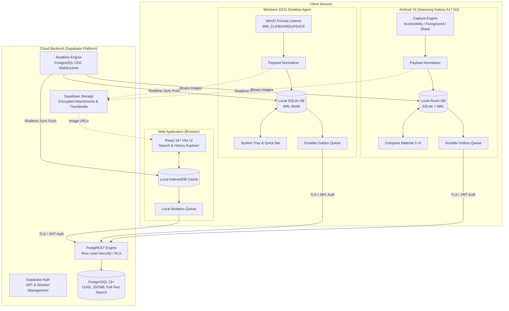
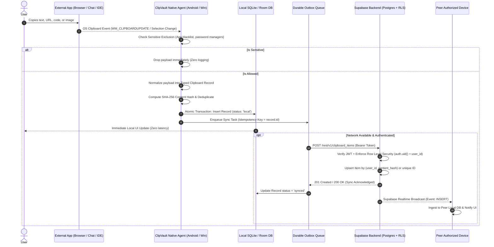

# SYSTEM ARCHITECTURE & DATA FLOW: CLIPVAULT

**Document Version:** 1.0.0  
**Phase:** Phase 0 (Discovery and Feasibility)  
**System:** Multi-Platform Clipboard Capture & Synchronization Engine  

---

## 1. High-Level System Architecture



---

## 2. End-to-End Data Flow



---

## 3. Universal Clipboard Data Model

The domain model is standardized across Android (Kotlin data classes), Desktop (TypeScript/Node.js), and Backend (PostgreSQL schema).

### 3.1 Domain Schema Contract (`ClipboardRecord`)

| Field | Type | Description | Indexing & Constraints |
| :--- | :--- | :--- | :--- |
| `id` | `UUID (v4)` | Globally unique identifier generated on capture device. | Primary Key |
| `user_id` | `UUID` | Supabase Auth user identifier. | Foreign Key -> `auth.users(id)` |
| `device_id` | `TEXT` | Hardware/session identifier of capturing device. | Indexed |
| `device_name` | `TEXT` | Friendly device name (e.g., "Samsung A17", "Workstation PC"). | Metadata |
| `content_type` | `TEXT` | Enum: `'text'`, `'url'`, `'code'`, `'rich_text'`, `'image'`, `'file_ref'`. | Indexed |
| `plain_text` | `TEXT` | Complete plain-text UTF-8 representation (no silent truncation). | Full-text indexed (`GIN` on `tsvector`) |
| `detected_url` | `TEXT` | Extracted and sanitized HTTP/HTTPS URL, if applicable. | Indexed |
| `html_content` | `TEXT` | Sanitized HTML fragment (for rich-text copies). | Nullable |
| `content_hash` | `TEXT` | SHA-256 hash of normalized payload for deduplication. | Unique composite `(user_id, content_hash)` |
| `content_size_bytes` | `INTEGER` | Byte length of raw payload. | Monitoring |
| `attachment_path` | `TEXT` | Local filesystem path to stored binary image/file. | Nullable |
| `attachment_url` | `TEXT` | Supabase Storage signed/authorized URL for cloud sync. | Nullable |
| `source_app` | `TEXT` | Package name / executable name (e.g., `com.brave.browser`). | Nullable (Privacy-safe) |
| `is_pinned` | `BOOLEAN` | User pinned status (pinned items are protected from retention). | Default `false`, Indexed |
| `is_favorite` | `BOOLEAN` | Starred/favorite flag. | Default `false`, Indexed |
| `tags` | `TEXT[]` | User-defined tags array for categorization. | GIN indexed |
| `captured_at` | `TIMESTAMPTZ` | Timestamp when user initiated the copy on device. | Default `NOW()`, Indexed DESC |
| `sync_status` | `TEXT` | Local status: `'local'`, `'pending_sync'`, `'synced'`, `'failed'`. | Local DB only |
| `retention_policy` | `TEXT` | Retention tag: `'permanent'`, `'30_days'`, `'session_only'`. | Default `'permanent'` |

---

## 4. Repository & Monorepo Structure

ClipVault is structured cleanly to support shared contracts while keeping platform runtimes decoupled:

```
clipvault/
├── docs/                      # Authoritative architecture, feasibility & test docs
│   ├── FEASIBILITY.md         # Hardware & OS feasibility audit
│   ├── ARCHITECTURE.md        # This document
│   ├── THREAT_MODEL.md        # Security, privacy & STRIDE threat model
│   ├── PLAN.md                # Phase-by-phase implementation roadmap
│   └── ACCEPTANCE.md          # Acceptance checklist & verification protocols
├── packages/
│   ├── shared/                # Universal TypeScript contracts, validators (Zod), and hash utils
│   │   ├── src/
│   │   │   ├── types/         # ClipboardItem, Device, SyncPayload interfaces
│   │   │   ├── validators/    # Zod schemas for zero-trust validation
│   │   │   └── utils/         # URL sanitizer, SHA-256 hashers, PII scrubber
│   │   └── package.json
│   ├── desktop-agent/         # Windows 10/11 native clipboard capture agent
│   │   ├── src/
│   │   │   ├── capture/       # Win32 clipboard listener & format normalizers
│   │   │   ├── db/            # Local SQLite database (WAL mode, schema migrations)
│   │   │   ├── sync/          # Durable outbox queue & Supabase sync engine
│   │   │   └── index.ts       # Service entry point & CLI controls
│   │   └── package.json
│   ├── web-dashboard/         # React 19 / Vite / Tailwind-free rich CSS dashboard
│   │   ├── src/
│   │   │   ├── components/    # Timeline, SearchBar, ItemCard, DeviceManager
│   │   │   ├── hooks/         # useClipboardHistory, useSyncStatus
│   │   │   ├── services/      # Supabase client & local IndexedDB cache
│   │   │   └── styles/        # Curated tokens, responsive layout, dark/light themes
│   │   └── package.json
│   └── backend-supabase/      # Supabase configuration, migrations & RLS policies
│       ├── migrations/        # 001_initial_schema.sql, 002_rls_policies.sql
│       └── seed.sql           # Development test seed fixtures
├── android/                   # Native Kotlin & Jetpack Compose Android application
│   ├── app/
│   │   ├── src/main/java/com/clipvault/app/
│   │   │   ├── capture/       # AccessibilityService, ForegroundService & TileService
│   │   │   ├── data/          # Room Database, DAO, Entities, TypeConverters
│   │   │   ├── sync/          # WorkManager outbox sync worker & Supabase client
│   │   │   └── ui/            # Jetpack Compose Material 3 screens & diagnostics
│   │   └── build.gradle.kts
│   ├── build.gradle.kts
│   └── settings.gradle.kts
├── tests/                     # Automated cross-platform test suites
│   ├── unit/                  # Data model, normalizer, and hashing tests
│   ├── integration/           # Local SQLite persistence & outbox sync tests
│   └── security/              # RLS policies, PII scrubbing, sensitive exclusion tests
├── AGENTS.md                  # Operating instructions for Antigravity agents
├── GEMINI.md                  # Mirror of AGENTS.md
└── package.json               # Root workspace scripts (build, test, dev)
```
